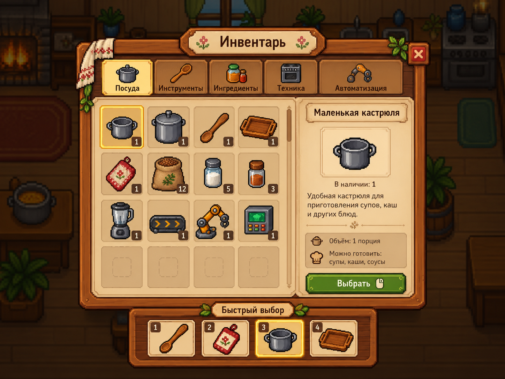
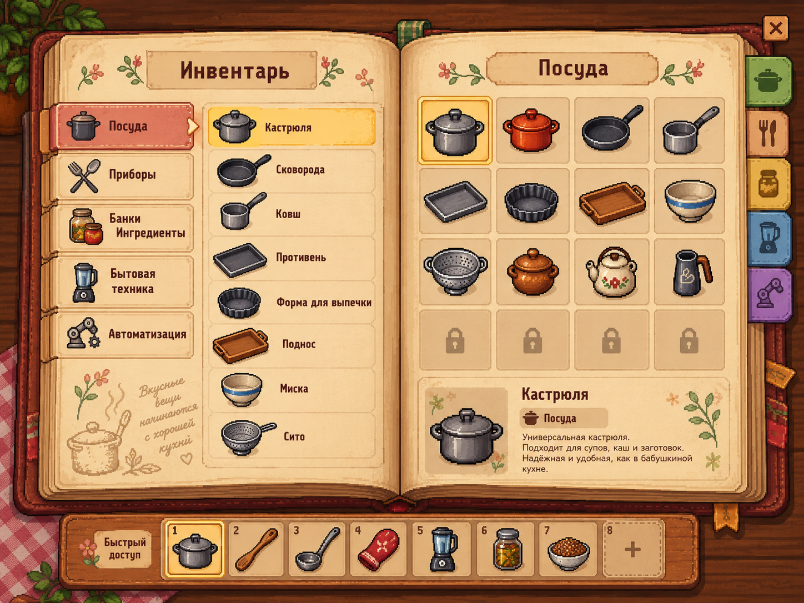
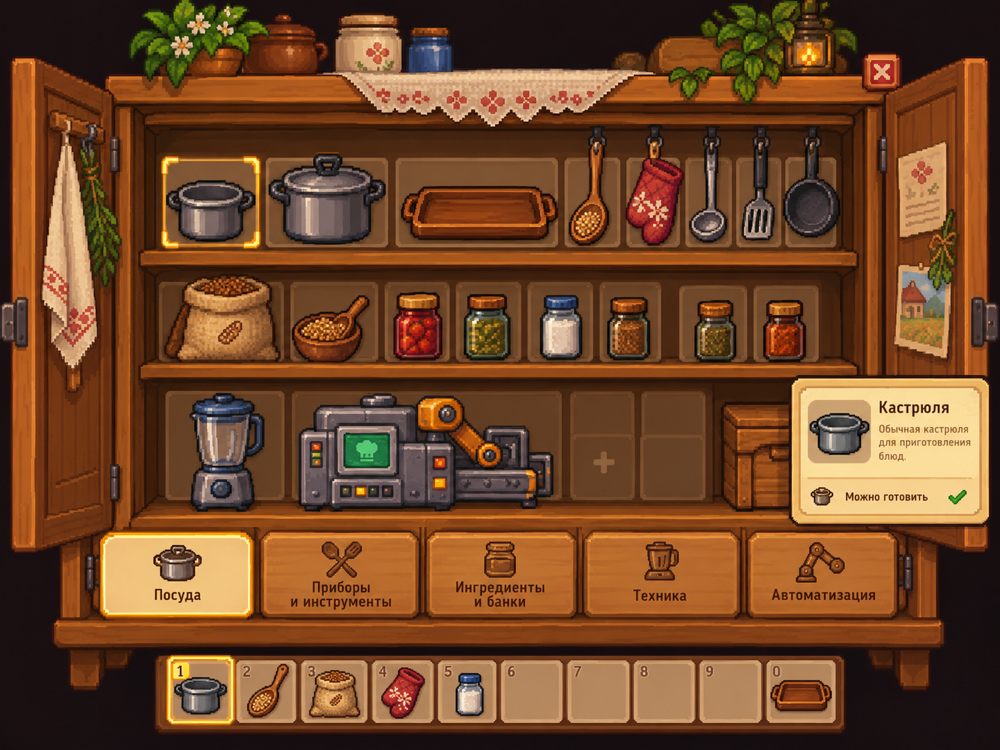
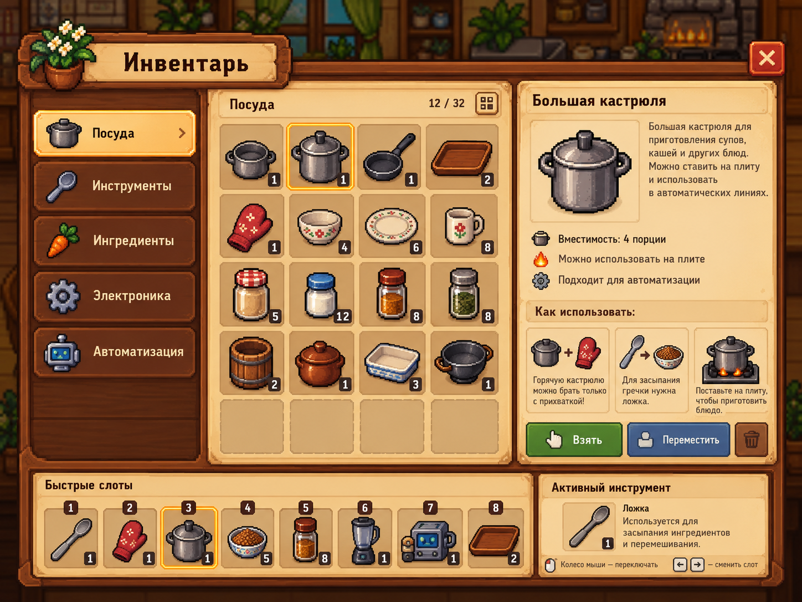

# Четыре варианта инвентаря

Все варианты предложены владельцем как допустимые визуальные направления. Окончательный вариант **не выбран**; это четыре альтернативы, не четыре интерфейса к одновременной реализации. Функциональные решения — [INVENTORY_DESIGN](../../../docs/INVENTORY_DESIGN.md). Все изображения1448×1086, полностью непрозрачные макеты, не атласы отдельных игровых спрайтов.

| Вариант | Чем отличается | Общие интересующие элементы |
|---|---|---|
| [01](inventory-01.png) | Компактное окно поверх кухни, горизонтальные категории, сетка, правая информация | Подсветка/выбор и отдельная нижняя быстрая панель |
| [02](inventory-02.png) | Раскрытая книга, категории/список слева, изображения и описание справа | Тематическое оформление, расширяемая навигация и быстрая панель |
| [03](inventory-03.png) | Шкаф/полки с предметами, категории снизу | Визуальное представление посуды/инструментов, активный предмет; не обязательная модель физического хранения в шкафу |
| [04](inventory-04.png) | Окно с левой навигацией, центральной сеткой, подробной правой карточкой и нижними быстрыми слотами | Описание/характеристики/подсказки, активный инструмент |

12/32, конкретные слоты/количества/вместимости/изображённые товары не являются утверждёнными ограничениями. В частности, инвентарь согласован без жёсткого лимита; вместимость отдельной кастрюли — другой параметр. Следующий шаг дизайнера — выбрать/согласовать общую раскладку и подготовить независимые элементы по отдельной карточке YouGile.

