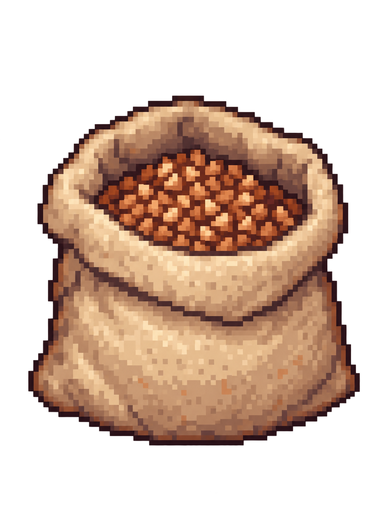
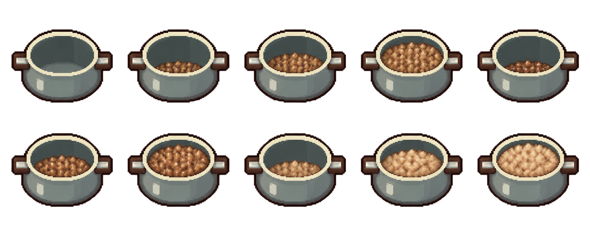

# Референсы предметов

Допустимые изображения владельца, **не внедрены**. Исходные файлы сохранены без обработки; [реестр/исходные имена](../manifest.json), [текущие игровые PNG](../../../docs/ASSETS.md) — разные наборы.

## Мешок гречки

[buckwheat-bag.png](buckwheat-bag.png),1086×1448. Один открытый наполненный мешок с крупой, есть реальная прозрачность/полупрозрачные пиксели. Это не полный набор полного/2⁄3/1⁄3/пустого мешка и не домашний контейнер. Будущие состояния обоих хранилищ ещё предстоит подготовить; контейнер по ёмкости меньше мешка. Не менять нынешние запасы/банку этим рисунком автоматически.

## Кастрюля с гречкой

[pot-buckwheat-states.png](pot-buckwheat-states.png),1983×793, лист2ряда×5изображений. Та же форма кастрюли с разным количеством/видом крупы; реальный alpha есть, также много полупрозрачных пикселей. Размер одного игрового кадра/точная сетка crop/Origin пока не утверждены, прямоугольные равные ячейки не считать готовой нарезкой.

**Возможная, не утверждённая трактовка** слева направо, затем второй ряд:0пустая;1–3сырая мало/средне/полно;4–6влажная/помытая мало/средне/полно;7–9светлая готовая мало/средне/полно. Визуально это10вариантов, но без подписей различие raw/washed нельзя считать доказанным. Перед интеграцией владелец/дизайнер утверждает соответствие стадиям, уровни, отсутствие ореолов/избыточной прозрачности и масштаб на поверхности/над головой.

Не заменять действующий PotVisual в задаче документации. Будущая арт-задача должна сохранить существующие состояния и не менять содержимое/баланс ради цвета картинки.

