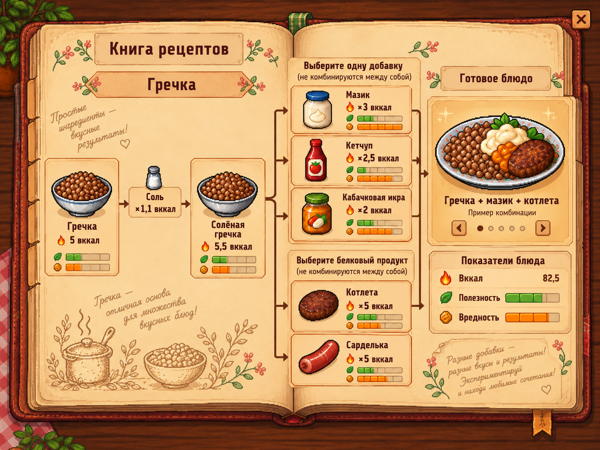
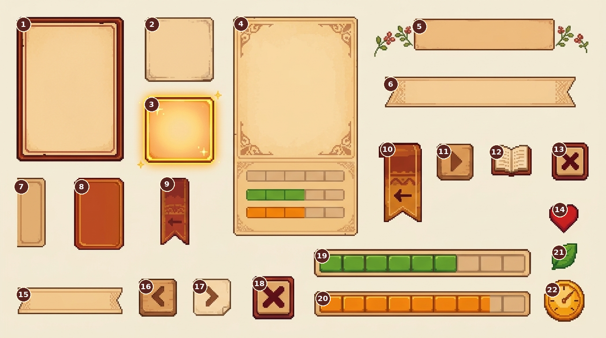
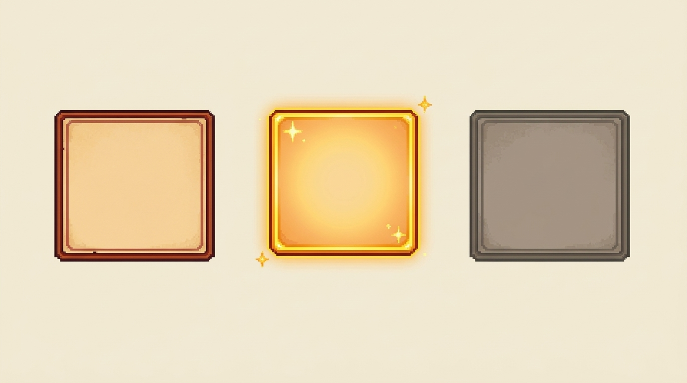

# Референсы книги рецептов

Допустимые материалы владельца; концепция — [RECIPE_BOOK_DESIGN](../../../docs/RECIPE_BOOK_DESIGN.md). Ничего из этого не импортировано в game/. Все четыре изображения этого раздела **полностью непрозрачные** (альфа=255 для всех пикселей; JFIF не поддерживает alpha), даже PNG. Перед спрайтовой интеграцией нужны отдельная подготовка прозрачности, нарезка/поля/Origin и проверка размеров; простой crop фона не удаляет.

| Файл | Что на нём | Назначение и ограничение |
|---|---|---|
| [buckwheat-page.png](buckwheat-page.png) | Макет раскрытой книги: гречка/соль, группы соусов и мяса, итоговое блюдо/показатели | Только композиционный ориентир, нельзя использовать всю страницу как статичный UI. Нарисованный огонь устарел: вккал обозначается сердцем. Числа/заполнение предварительные, не действующий баланс. |
| [ui-atlas.jfif](ui-atlas.jfif) | Не пронумерованный атлас рамок/кнопок/вкладок/стрелок/иконок/шкал | Может служить источником подготовки отдельных элементов; сейчас не готов к прозрачной интеграции. Исходник имел GUID-имя, mapping в manifest. |
| [ui-atlas-numbered.png](ui-atlas-numbered.png) | Тот же набор с номерами1–22 | Справочная схема, номера не часть будущих спрайтов. Читать вместе с исходным TXT ниже. |
| [Номерованные-элементы.txt](Номерованные-элементы.txt) | Назначение22номеров | Исходный текст сохранён без правок, в7/8 назначения предварительные («предположительно»/«вероятно»). Не терять связь с numbered-atlas. |
| [card-states.png](card-states.png) | Обычная, золотая, серая карточки | Визуальный ориентир: открытая; открытая выбранная; неизвестная. Selected не равен discovered. Одна текстура содержит3варианта, требует подготовки. |

При проверке обнаружено: файл с GUID и расширением.jfif — именно полный атлас, другой GUID.png — именно три карточки; назначения определены по содержимому, не по случайному исходному имени.

## Нумерация элементов

Эта краткая таблица помогает перейти от изображения к смыслу; исходный TXT остаётся первичным описанием номеров.

| № | Элемент / назначение |
|---:|---|
| 1 | Большая карточка рецепта: изображение/название/описание |
| 2 | Обычная маленькая карточка ингредиента |
| 3 | Подсветка выбранного ингредиента |
| 4 | Высокая карточка итогового блюда/трёх показателей |
| 5 | Цветочный заголовок страницы |
| 6 | Лента заголовка группы |
| 7 | Предположительно обычная вкладка категории |
| 8 | Вероятно выбранная категория |
| 9 | Компактная кнопка назад |
| 10 | Большая боковая кнопка назад |
| 11 | Кнопка вправо/следующий вариант |
| 12 | Раскрытая книга: открыть вложенный рецепт |
| 13 | Закрытие книги |
| 14 | Сердце: вккал |
| 15 | Альтернативная лента заголовка |
| 16 | Предыдущая комбинация |
| 17 | Следующая комбинация |
| 18 | Альтернативное закрытие |
| 19 | Зелёная шкала полезности |
| 20 | Оранжевая шкала вредности |
| 21 | Лист полезности |
| 22 | Янтарный прибор вредности |

Шкалы19/20/встроенные полоски4 нужно делать программно заполняемыми; нарисованные уровни не фиксированные значения. Границы декора/углов свободны от основных интерактивных элементов. Полноценный фон пустой книги и игровые рамки/иконки/связи готовить отдельно; не вырезать из целой страницы уже набитую неизменяемую книгу.

